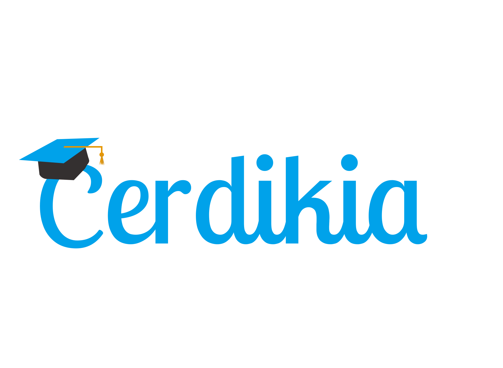
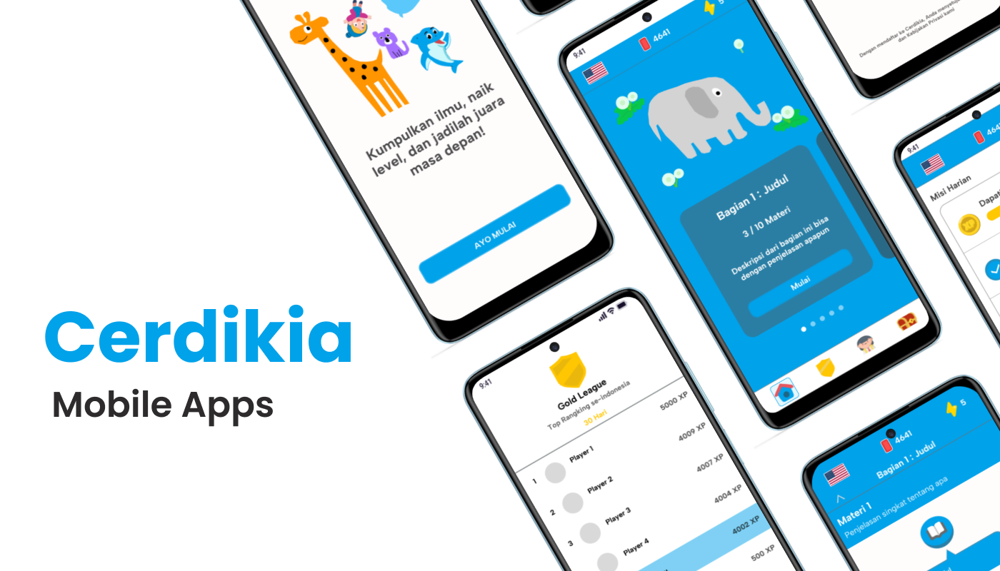
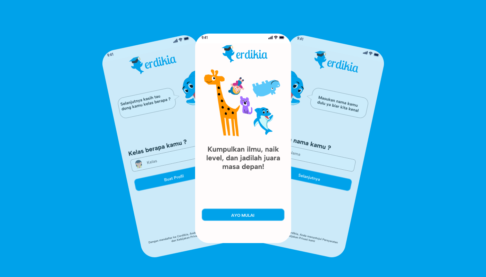
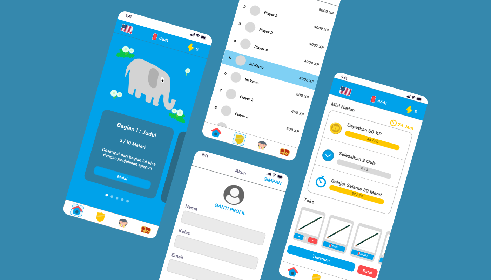
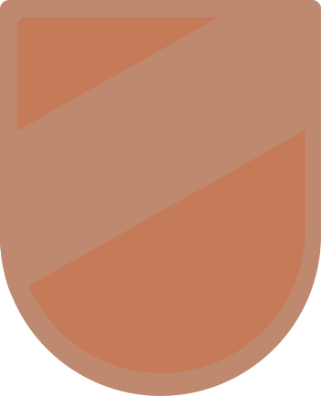
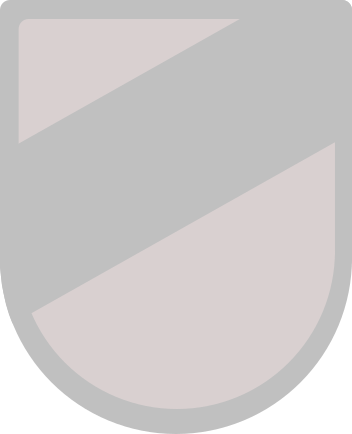
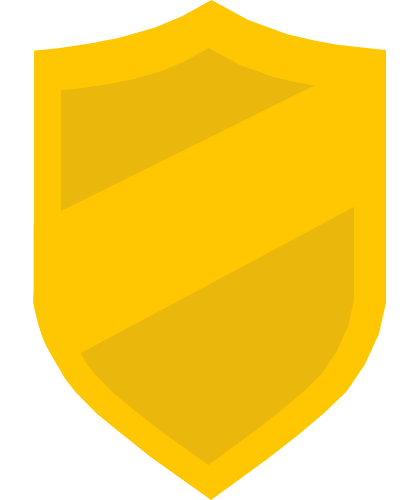
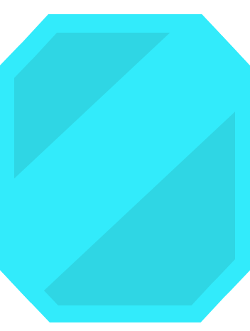

  
  <h1>Cerdikia — Belajar Jadi Petualangan</h1>
  
Landing page untuk aplikasi belajar interaktif Cerdikia.

  

    <a href="https://github.com/Cerdikia/CerdikiaMobile/releases/download/v1.0.2/Cerdikia.apk"><strong>Unduh aplikasi Android</strong></a>
    ·
    <a href="https://github.com/Cerdikia/CerdikiaMobile/releases/tag/v1.0.2">Lihat release v1.0.2</a>
  

  

    
    
    
    
    
    
  

  

## Tentang Cerdikia

Cerdikia adalah aplikasi belajar mobile yang membawa materi dan latihan ke dalam pengalaman yang terasa seperti petualangan. Siswa dapat menjelajahi materi, mengerjakan kuis, menyelesaikan misi, mengumpulkan XP, dan melihat progres mereka melalui ranking.

Landing page ini memperkenalkan pengalaman tersebut lewat galeri tampilan aplikasi, sistem tier ranking, dan tautan unduh APK Android.

## Jelajahi fitur aplikasi

| Belajar dan latihan | Misi, XP, dan reward |
|:--:|:--:|
|  |  |
| Kenali karakter Cerdikia dan mulai dari profil belajar. | Kumpulkan XP dari aktivitas belajar, ikuti misi, lihat ranking, dan tukarkan reward. |

### Perjalanan ranking

XP yang terkumpul membantu siswa naik melalui lima tier berikut:

|  |  |  |  |  |
|:---:|:---:|:---:|:---:|:---:|
| Bronze | Silver | Gold | Platinum | Diamond |
| XP minimum: 0 | XP minimum: 1.000 | XP minimum: 2.000 | XP minimum: 3.000 | XP minimum: 5.000 |

## Unduh aplikasi

APK Android tersedia melalui GitHub Releases. Tombol unduh di landing page menggunakan URL file APK secara langsung agar pengunjung langsung memulai unduhan.

- [Unduh Cerdikia.apk](https://github.com/Cerdikia/CerdikiaMobile/releases/download/v1.0.2/Cerdikia.apk)
- [Buka catatan release v1.0.2](https://github.com/Cerdikia/CerdikiaMobile/releases/tag/v1.0.2)
